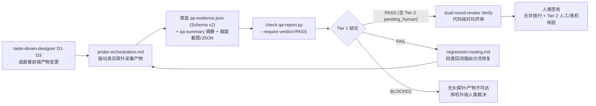

# `frontend-qa-gate` 前端产物验收技能架构设计书 (Architecture & Design Specification)

> **文档控制信息**
> - **文档标识**: SKILL-QA-FRONTEND-GATE-2026
> - **当前版本**: V2.0.0 (V2.0 双轨实采化升级：拆分 Tier 1 自动化 23 项阻断门禁与 Tier 2 4 项人工/真机签收清单，引入现代探针编排协议与 Schema v2 Fail-Closed 真实磁盘证据 JSON 门禁，正式确立五域运行时断言 SSOT 归位)
> - **文档状态**: Active
> - **文档所有者**: 核心架构组
> - **生效日期**: 2026-11-24
> - **技能入口**: [skills/frontend-qa-gate/SKILL.md](../../../skills/frontend-qa-gate/SKILL.md)
> - **理论基准**: [《前端开发转向 AI Coding 的常见问题全景：研究证据、风险分层与验收清单》](../../reference/articles/ai-coding-frontend-common-problems.md)（kejun，2026-09-20 修订版）
> - **评估与调研依据**: [架构重构评估报告](../analysis/2026-11-23-frontend-qa-gate-architecture-evaluation.md) · [同类前沿调研报告](../analysis/2026-11-23-frontend-qa-gate-peer-research.md) · [Wave 3 实施计划](../../project/plans/2026-11-24-wave3-frontend-skills-v2.md)
> - **核心契约锚点**: [acceptance-matrix.md](../../../skills/frontend-qa-gate/references/acceptance-matrix.md)（五域运行时断言 SSOT）、[regression-routing.md](../../../skills/frontend-qa-gate/references/regression-routing.md)

---

### 修订历史记录 (Revision History)

| 版本号 | 修订日期 | 修订人 | 审核人 | 修订描述 |
| :--- | :--- | :--- | :--- | :--- |
| **V2.0.0** | 2026-11-24 | AI Agent | 核心架构组 | V2.0 实采化升级：拆分 **Tier 1（23 项自动化阻断）+ Tier 2（4 项 `pending_human` 人工/真机签收）**双轨门禁破除无头死锁，移除越界 `S9`；新增 `references/probe-orchestration.md` 现代探针编排；废弃中文 Markdown 正则校验器、兼容壳与重型手工模板，重铸 Schema v2 Fail-Closed 真实磁盘证据 JSON 门禁 `check-qa-report.py`；确立 `acceptance-matrix.md` 为五域断言唯一真相源 |
| **V1.0.0** | 2026-09-21 | AI Agent | 核心架构组 | 首版：以 kejun 文献六类风险与「风险分层」「十条防御清单」为需求源，确立五域 31 条产物断言、PASS/FAIL/BLOCKED 三态与缺陷回流路由 |

---

## 1. 背景与目标 (Problem & Goals)

AI 生成前端代码的速度不断提升，但理论基准文献给出的实证证据指出：**生成快不等于交付可用**。三条核心证据：

1. **设计说明与实际实现存在落差**（Design Theater 研究）：平均超过 25% 的面向用户设计说明未在界面中落实，功能性要求未落实比例为 34%；
2. **公开 AI 生成前端项目中存在结构性缺陷**（165 个仓库筛出 123 个可分析项目）：74% 存在阻止发布的严重错误、52% 存在严重无障碍错误、49% 表单输入缺少标签、19% 图标按钮缺少可访问名称；
3. **异常处理与验证成本**：AI 协作 PR 的错误处理与异常路径缺失接近人工 PR 的 2 倍；38% 开发者认为审查 AI 代码比审查同事代码更费力。

仓库既有的质量技能职责边界：

| 技能 | 回答的问题 | 缺口 |
|---|---|---|
| `taste-driven-designer` | 设计是否有品味、方向与减法是否到位 | 不覆盖运行时可验证性（响应式、状态、无障碍、性能） |
| `dual-round-review` | 代码是否正确（静态推理、状态派生实现、竞态与并发安全） | 判据是 Diff 与代码推理，不产出真实浏览器行为证据 |

**V1.0 教训与 V2.0 目标**：V1.0 虽然确立了正确的思想内核（拒绝主观评分、诚实标示未验证项、四类缺陷精确回流），但在工程上滑向「零浏览器采集编排 + 433 行中文自然语言正则验表（5 组对抗探针全击穿 Exit 0）+ 把无头不可达的真机读屏/安全区列为阻断项造成 100% `BLOCKED` 死锁」。V2.0 彻底转型为**「双轨门禁架构 + 现代探针编排 + 真实磁盘证据 JSON 门禁」**，让门禁盯住真实运行物证而非排版文字。

---

## 2. 理论支柱 (Theoretical Pillars)

| 支柱 | 来源 | 对应机制 |
|---|---|---|
| **真实运行物证优先于自然语言叙述** | 文献 A7「完成报告失真」与防御清单第 1、3 条 | **Schema v2 JSON 物证契约**：禁止用正则校验散文，只核验磁盘真实存在的非空截图/探针 JSON、二进制魔数与运行时计数清零 |
| **双轨风险分层破解无头死锁** | 文献「风险分层」表 + 无头执行边界审计 | **Tier 1 自动化阻断门禁**（无头浏览器/CI 必过，三态 `PASS`/`FAIL`/`BLOCKED`）+ **Tier 2 人工/真机签收清单**（标 `pending_human` 不阻断自动化放行） |
| **把约束变成可机器核验的规则** | 文献防御清单第 7 条 | Fail-Closed 证据门禁（symlink 防逃逸 / 魔数 / 占位符 / `runtime_signals` 与 `verdict` 推导一致性）；安全类显式交给宿主 CI |
| **工具分数不等于可用性验收** | 文献 A6「自动化工具不能覆盖全部可用性问题」 | 无障碍自动扫描（如 axe）不独立构成 `PASS`，必须叠加 Tier 1 键盘/焦点实测与 Tier 2 读屏人工签收 |
| **相对/二值判据优于绝对评分** | `taste-driven-designer` 反证（E1/E2/E3） | 本技能不输出任何分数、等级或通过率；Tier 1 结论仅限三态 |
| **与代码审查保持单一职责正交** | `dual-round-review` 边界原则 | 移出原越界代码推导项 `S9`；本技能只产运行态产物断言与物证，不侵占 Diff 代码级推理 |

---

## 3. 双轨门禁流程拓扑 (Dual-Track Process Topology)

**双轨放行语义**：
- **Tier 1 自动化阻断门禁**：覆盖 23 项可由无头浏览器与构建脚本验证的运行时断言。只有 Tier 1 全部通过且真实磁盘证据经过 `check-qa-report.py --require-verdict=PASS` 校验退出码为 `0` 时，才允许流转至 `dual-round-review`；`FAIL` 按回流路由修复重验，`BLOCKED`（宿主连基本无头浏览能力或目标地址均不可达）须停机上报。
- **Tier 2 人工/真机签收清单**：覆盖 4 项无头环境物理不可达的真机/读屏体验项。在自动化交付阶段统一标注为 `pending_human` 并附入人类可读摘要，**不阻断自动化验证进入后续代码终审，也不得伪造为自动化 `PASS`**，由人类在真机发布前最终签收。

---

## 4. 双轨断言体系与 SSOT 归位 (Dual-Track Assertions & SSOT)

本技能的 [acceptance-matrix.md](../../../skills/frontend-qa-gate/references/acceptance-matrix.md) 是**五域运行时产物断言的唯一真相源（SSOT）**（V2.0 正式取消 V1.0「`taste` 内联副本」历史表述，彻底消除跨技能 Split-Brain）。全矩阵收敛为 **23 项 Tier 1 + 4 项 Tier 2**：

### 4.1 Tier 1 Automated Block-Merge Gate（23 项 · 阻断合并）

| 域 | 条目数 | 关键覆盖与 V2.0 调整要点 |
| :---: | :---: | :--- |
| **D-R 响应式视口** | **5** | 连续适配与断点核心项：最小宽度（320/375px）无横向滚动条、无元素溢出或遮挡、长文本/超长词不撑破布局、触控目标 ≥ 44×44 CSS px、200% 缩放不丢失内容或功能 |
| **D-S 交互状态** | **8** | 运行时可观测交互态：初始渲染稳定、加载态可见、空态指引、错误态保留用户输入与重试、禁用态视觉与语义属性、键盘焦点可见、防重复提交/幂等、返回不丢状态（**已移除原越界的代码推导项 `S9`，该项归位 `dual-round-review` 代码审查**） |
| **D-A 无障碍** | **7** | 输入控件关联标签、图标按钮可访问名称、仅键盘完成主干流程、焦点顺序合理且弹窗焦点不逃逸、尊重 `prefers-reduced-motion`、标题/landmark/列表语义结构正确、动态状态变化可被感知（`aria-live`）；强调自动扫描 + 键盘实测结合 |
| **D-P 性能预算** | **3** | 构建产物体积相对基线无未解释增长、关键交互延迟未回归、非首屏媒体懒加载与尺寸声明合理 |

### 4.2 Tier 2 Human & Device Sign-Off Checklist（4 项 · `pending_human`）

| 清单编号 | 原对应维度 | 人工/真机签收内容 |
| :---: | :---: | :--- |
| **H-A5** | 无障碍读屏 | 真实屏幕阅读器（VoiceOver / NVDA）完整走通主干交互流程 |
| **H-V4/V5** | 真机移动端适配 | 真机软键盘弹出不遮挡关键输入与提交按钮、刘海屏/圆角安全区生效 |
| **H-V6** | 方向切换 | 真机或真机容器横屏与竖屏旋转切换后布局完整可用 |
| **H-B1/B2** | 浏览器覆盖矩阵 | 目标浏览器最低支持版本与多引擎矩阵（含 Safari / WebView）实机流程核验 |

---

## 5. 现代探针编排协议 (`references/probe-orchestration.md`)

V2.0 彻底放弃“手工填写 8 节长篇报告”的纸面模式，通过 `references/probe-orchestration.md` 将宿主已安装或项目自带的真实可执行浏览器/审计工具编排进采集链路（宿主无关、按可用性探测路由）：

| 能力域 | 优先编排探针路由 | 落盘产物（供 JSON 门禁核验） |
|---|---|---|
| **运行时交互 / 控制台 / 网络信号** | `chrome-devtools-mcp` / `agent-browser`（交互快照与 `dogfood`）/ Playwright（`webapp-testing`） | 各断点与状态截图（`.png`/`.jpg`/`.webp`）、`runtime_signals` 计数（`console_errors`、`page_errors` 及可选 `axe_critical_serious`） |
| **无障碍扫描与语义树** | `chrome-devtools-mcp`（`a11y-debugging`） / `@axe-core/playwright` + 键盘实测脚本 | a11y 扫描原始报告（`.json`）与键盘焦点轨迹证据 |
| **性能与构建预算** | `chrome-devtools-mcp`（`debug-optimize-lcp`） / Lighthouse CI（`lhci`）/ 构建产物对比输出 | Lighthouse / 构建体积对比文件（`.json`） |

若目标产物无可访问 URL/构建输出，或宿主无任何可用的无头浏览器探针驱动，按铁律输出 `BLOCKED` 并如实列出阻断原因，严禁凭静态代码阅读伪造运行态 `PASS`。

---

## 6. 真实磁盘证据 JSON 门禁 (`scripts/check-qa-report.py`，Schema v2)

V2.0 废弃 433 行中文自然语言正则解析器与 `.sh` 兼容壳，将产物验收机器接口重构为结构化 JSON Schema v2（模板 `templates/qa-evidence-template.json` + 人类可读摘要模板 `templates/qa-summary-template.md`）。`scripts/check-qa-report.py` 实施 **Fail-Closed 真实磁盘物证校验**：

1. **Schema 结构与占位符拦截**：校验必备顶层字段（`schema_version`、`artifact`、`runtime_signals`、`automated_assertions`、`human_signoff`、`verdict`）及核心域覆盖；拦截任何未填充占位符（`<...>` 等）；
2. **物理磁盘存在性与非空**：逐条解析所有 `passed` 断言引用的磁盘证据相对路径，必须真实存在于 `--evidence-root` 内且文件大小 > 0 字节；
3. **symlink 防逃逸**：解析证据文件的真实物理路径（`resolve`），严禁绝对路径、`..` 越界或通过符号链接逃出 `--evidence-root` 边界；
4. **魔数格式强校验**：对声明的图片或结构化报告核验二进制文件头魔数（`.png`、`.jpg`、`.webp`）与合法 `.json` 语法，拦截空壳重命名伪造（如文本改后缀 `.png`）；
5. **`runtime_signals` 计数清零与 `verdict` 推导一致性**：核验 `console_errors`、`page_errors`（及可选 `axe_critical_serious`）均为非负整数且清零，且所有断言状态与总 `verdict`（`PASS` / `FAIL` / `BLOCKED`）推导一致——存在任意 `failed` / `unverified` 或 `runtime_signals > 0` 时严禁输出 `PASS`；
6. **Tier 2 兼容放行**：合法标记为 `pending_human` 的 `human_signoff` 项不阻断 `--require-verdict=PASS`，同时禁止将未实测的 Tier 2 项伪造标为自动化 `PASS`。

---

## 7. 角色模型与既有技能接口 (Roles & Interfaces)

| 角色 | 承担者 | 职责边界 |
|---|---|---|
| **验收执行者** | 主智能体（含探针子智能体） | 编排探针采集运行物证、生成 `qa-evidence.json` 与摘要、按 `regression-routing.md` 分流缺陷 |
| **机器物证门禁** | `scripts/check-qa-report.py` | 校验磁盘真实物证、魔数、防逃逸、`runtime_signals` 与 `verdict` 一致性 |
| **代码级终审者** | `dual-round-review` | 根因类与代码级问题（含原 `S9` 派生状态实现）的独立对抗终审 |
| **品味与方向裁决者** | `taste-driven-designer` Critic + 人类创意总监 | 视觉品味、表面模式与结构重排 |
| **放行与 Tier 2 签收者** | **人类（用户）** | 最终发布放行权与 Tier 2 `pending_human` 真机/读屏核验签收 |

### 7.1 与 `taste-driven-designer` 接口
- 顺序：`taste-driven-designer` D1–D3 → 本技能 → `dual-round-review`；
- **SSOT 归位**：本技能 `references/acceptance-matrix.md` 为五域运行时断言的唯一真相源（不再自称 `taste` 内联副本）；
- 结构类缺陷（视口下信息层级崩坏、密度失衡）经 [regression-routing.md](../../../skills/frontend-qa-gate/references/regression-routing.md) 回流至 `taste-driven-designer` D2 重调后重验。

### 7.2 与 `dual-round-review` 接口
- 原 `S9`（派生状态代码推理）连同 hydration 推理、类型逃逸、依赖边界、竞态实现与资源泄漏全部归位 `dual-round-review` 审查维度与失败模式库；
- 根因类缺陷转出时提供最小上下文（现象与最小复现、断言 ID 与证据路径、怀疑范围、已排除假设），引用失败模式库只引用编号与名称（如模式 11 / 模式 3 / 模式 5）。

### 7.3 与 `goal-loop` 接口
- **挂载点**：`Verify` 阶段子步骤 4.2（原 P3.5，前端产物交付时的条件步骤，位于 R1 之前）；
- **标准命令**：`python3 <frontend-qa-gate 技能目录>/scripts/check-qa-report.py <qa-evidence.json> --require-verdict=PASS`；
- **放行口径**：Tier 1 真实磁盘证据校验 `PASS`（退出码 0）即可放行进入 `dual-round-review`；Tier 2 人工/真机项按 `pending_human` 呈交人类签收，不造成无头环境死锁；`FAIL`/`BLOCKED` 严禁进入后续终审合并。

---

## 8. 质量指标与测试策略 (Quality Metrics & Test Strategy)

| 层次 | 指标 / 门禁 | 覆盖文件与测试要点 |
|---|---|---|
| **L0 静态** | `python3 -m py_compile`、`git diff --check` | `scripts/check-qa-report.py` 语法洁净、技能内相对链接与围栏闭合校验 |
| **L1 磁盘证据门禁单元** | `pytest`（`tests/test_frontend_qa_evidence_gate.py`） | 真实磁盘物证行为边界测试：合法 Schema v2 `PASS`（含 Tier 2 `pending_human`）、缺失证据文件阻断、0 字节文件阻断、symlink 越界逃逸阻断、伪造 `.png`/`.jpg`/`.webp`/`.json` 魔数拦截、占位符拦截、`runtime_signals` 未清零阻断、`verdict` 逻辑矛盾阻断、`--require-verdict=PASS` 精确退出码 |
| **L1 表面与防回流哨兵** | `pytest`（`tests/test_frontend_qa_v2_surface.py`） | `SKILL.md` YAML frontmatter 与 `description` 长度预算、双轨 23+4 条目结构对齐、`qa-evidence-template.json` 合法 JSON 与结构校验、跨技能硬链接零违规、以及已退役正则校验/旧模板文件名防回流哨兵 |
| **L2 全仓集成与 L-Doc 治理** | `python3 -m pytest skills/ scripts/ -q` 与 `python3 scripts/doc-gates/check-all.py --full` | 全仓测试零回归；断链 0、文档健康度 PASS、可回答性评测无 FAIL |
| **方法论保真** | 人工 + 红队终审 | 文献六类风险、「风险分层」与「十条防御清单」映射到双轨门禁与 `references/acceptance-matrix.md` 逐条可寻址 |

---

## 9. 边界与不承诺 (Boundaries & Non-Goals)

- 不强绑定某一家浏览器驱动/测试框架的具体二进制安装包——通过 `probe-orchestration.md` 编排宿主或项目已有探针；
- 不覆盖代码级审查（归 `dual-round-review`）；不覆盖品味与方向裁决（归 `taste-driven-designer`）；
- 不覆盖安全与供应链（XSS / 密钥 / 依赖投毒）——属宿主 CI 与权限层，技能只负责记录与升级；
- 不承诺「跑完本技能即零缺陷」：双轨门禁校验运行态证据，不是缺陷率的事实保证；
- 不输出任何绝对分数、等级或通过率。

### 9.1 与文献原意的显式偏离 (Registered Deviations)

| # | 文献原意 | 本技能的处置 | 依据 |
| :---: |---|---|---|
| D1 | 文献逐项列出风险条目，未规定责任归属 | 按「可机器判定 → CI；产物行为 → 技能；代码推理 → 代码级审查」三分法显式划界，安全类与派生状态代码推理移出技能范围 | 文献防御清单第 7 条「把约束变成可执行规则；能够自动判断的事项进入 CI」；技能文档无法提供安全扫描与权限强制力 |
| D2 | 文献建议「自动扫描结合键盘与读屏检查」但未定义门禁 | 本技能把「自动扫描不得作为结论」写成铁律，在 V2.0 中分层为 Tier 1 自动扫描+键盘实测必过，与 Tier 2 读屏实测 `H-A5` 显式标 `pending_human` 交人类签收 | 文献 A6 明确「自动化工具不能覆盖全部可用性问题，也不能仅凭工具分数宣布验收完成」，同时避免无头环境下产生永久死锁 |
| D3 | 文献主张按风险调整验收深度，未给出评分机制 | 本技能拒绝任何分数/通过率，Tier 1 仅用 `PASS` / `FAIL` / `BLOCKED` 三态，Tier 2 用 `pending_human` 签收态 | `taste-driven-designer` V1.1 实跑反证：绝对分数区间压缩、与改动无相关、无鉴别力 |
