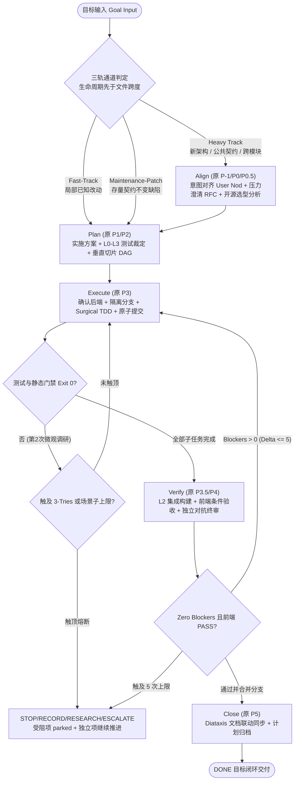

# `goal-loop` 目标实现循环技能架构设计书 (Architecture & Design Specification)

> **文档控制信息**
> - **文档标识**: SKILL-DES-GOAL-LOOP-2026
> - **当前版本**: V3.0.0 (五主阶段收敛、退役零用 tracker 与伪运行时、引入 pack-handoff.py 交接脚本与 2026 四大编排纪律)
> - **文档状态**: Active
> - **设计所有者**: 王辉
> - **设计架构师**: Antigravity AI Agent
> - **创建日期**: 2026-09-08
> - **生效日期**: 2026-11-23
> - **参考基准**:
>   - [skills/goal-loop/SKILL.md](../../../skills/goal-loop/SKILL.md) —— 路由层唯一入口（五主阶段、三轨分流与 11 条铁律）
>   - [架构重构评估报告](../analysis/2026-11-23-goal-loop-architecture-evaluation.md) —— V2.x 28 份真实计划实证审计与 V3.0 瘦身升级方案 A
>   - [同类前沿调研报告](../analysis/2026-11-23-goal-loop-peer-research.md) —— 2026 年代多智能体编排标杆横向对标
>   - [Wave 2A 实施计划](../../project/plans/2026-11-23-wave2a-goal-loop-v3.md) —— V3.0 架构裁决与任务拆解基线
>   - 工业级工程 TDD 闭环规范、Manus 上下文工程（事件驱动落盘）与 Ralph Loop 磁盘持久化理念
>   - 宿主原生能力族（步骤清单原语、隔离工作区子智能体、工作流编排）及内部技能生态（`brainstorming`、`grilling`、`clarification-protocol`、`research`、`writing-plans`、`frontend-qa-gate`、`dual-round-review`、`doc-governance`）

---

### 修订历史记录 (Revision History)

| 版本号 | 修订日期 | 修订人 | 审核人 | 修订描述 |
| :--- | :--- | :--- | :--- | :--- |
| **V3.0.0** | 2026-11-23 | AI Agent | 王辉 | 五主阶段收敛（`Align → Plan → Execute → Verify → Close`）；退役零使用正则状态脚本与两份僵尸模板；拆除不可度量重入伪运行时；升级事件驱动落盘与 Diátaxis 文档联动；引入极薄文件指针交接脚本 `pack-handoff.py` 与四项 2026 执行自治纪律 |
| **V2.1.0** | 2026-10-12 | AI Agent | 王辉 | 引入宿主无关三档执行后端、派发账本与超期收口机制、可选外部技能三分支无头安全降级及 `Maintenance-Patch` 存量维护通道 |
| **V2.0.0** | 2026-09-14 | AI Agent | 王辉 | 确立计划文件为唯一人类可读真相源，路由层 `SKILL.md` 瘦身，统一阶段编号并补齐子任务第 8 节输出契约 |
| **V1.0.0** | 2026-09-08 | AI Agent | 王辉 | 初版：确立长程目标循环闭环状态机、L0–L3 测试分级判定矩阵与独立双轮对抗终审门禁 |

---

## 1. 背景与核心痛点 (Problem Statement)

在 LLM 驱动的长程软件研发（Long-Horizon Tasks）中，无状态单会话模式面临六类系统性失效：

1. **上下文腐化 (Context Rot)**：连续数十步后历史输出填满窗口，推理质量下降并触发幻觉或目标偏移；
2. **需求失准与盲目编码**：缺少前置意图对齐、术语收敛与开源选型，直接写代码导致高额返工；
3. **测试「一刀切」或形式主义**：微小改动盲跑全量 E2E 或跨模块契约改动仅靠肉眼审查，缺乏基于影响面的分级测试裁定；
4. **过早宣告完成与浅层补丁**：缺少独立审查隔离，作者自验导致创可贴式修复流入主干；
5. **盲目试错死循环 (Infinite Retry Hell)**：遇到失败无上限微调，消耗轮次且破坏既有架构；
6. **中断后状态丢失**：网络抖动、会话压缩或重启后无持久化锚点，无法判断已落盘进度与待办断点。

---

## 2. 第一性原理与设计支柱 (Design Pillars)

`goal-loop` V3.0 建立在四大经实证检验的设计支柱之上：

1. **计划文件单一真相源 + 事件驱动落盘**：上下文窗口是易失内存，文件系统是持久磁盘。计划头部 `Active Checkpoint` 由智能体直接精准编辑维护（废除 0% 使用的正则 Markdown 解析脚本与机械每 2 次只读强制写盘），仅在**阶段切换、关键根因/契约确立、大块探索收敛、上下文压缩前（PreCompact）**四大关键事件强制落盘，长日志按需卸载至 `.goal-loop/scratchpad.md`。
2. **三轨通道分流与生命周期优先判据**：以「任务生命周期阶段（维护 vs 开发）」先于「改动文件跨度」分流——`Heavy Track` 守复杂架构质量、`Fast-Track` 降局部改动开销、`Maintenance-Patch` 专攻既有契约不变的存量故障（强制先复现、最小修复、必带回归、Diff 边界锁）。
3. **改动特征 → L0–L3 测试定级与防逃逸**：通过影响面分析、I/O 边界穿透与用户可感知性四步推理生成《测试策略裁定书》，并明确禁止以单测内部 Mock 伪称纯内存逻辑来逃逸 L2 集成测试。
4. **隔离委派 + 2026 编排经济性**：通过 `scripts/pack-handoff.py` 传递文件路径指针防止主上下文滚雪球；以「先裁决不卡死（Rulings, not stalls）」「通用能力档位模型分层」「同形小改动合批 + 禁套娃审查」「垂直曳光弹切片（DAG）」平衡自治效率与质量门禁。

---

## 3. 总体架构与五主阶段状态机 (5-Stage State Machine)

V3.0 将历史演化积累的补丁式编号（`P-1` 至 `P5`）收敛为 **`Align → Plan → Execute → Verify → Close`** 五个正交主阶段，并通过三轨裁剪矩阵控制子步骤启停（各阶段同时保留历史编号映射以兼容存量计划）：



---

## 4. 自适应分级测试体系 (Change-to-Test Decision Framework)

核心规程见 [testing-decision-matrix.md](../../../skills/goal-loop/references/testing-decision-matrix.md)（全技能核心护城河）：

| 级别 | 测试类型 | 运行阶段 | 核心关注点 | 典型命令 |
|:---:|---|:---:|---|---|
| **L0** | 静态门禁 | `Execute` 每次变更 | 语法、类型安全、Lint、死代码清理 | `tsc --noEmit`, `eslint`, `mypy`, `cargo check` |
| **L1** | 单元测试 | `Execute` TDD 循环 | 纯逻辑、边界分支、状态流转 | `pytest`, `vitest run`, `go test` |
| **L2** | 集成测试 | `Verify` 集成验证 | 跨模块契约、存储/I/O 装配、全局构建 | 集成测试套件 + 全局编译构建 |
| **L3** | 端到端测试 | `Verify` 终审前置 | 用户主干链路、CLI 全流程真实产物 | `playwright test`, 端到端验收脚本 |
| **L-Doc** | 文档门禁 | `Close` 归档阶段 | 断链、版本一致、机器地图、格式规范 | `check-all.py`, link-checker |

智能体在 `Plan` 阶段必须执行**影响面分析 → I/O 边界穿透（含 Mock 防逃逸红线）→ 用户感知性检查 → 固化《测试策略裁定书》**四步推理。

---

## 5. 外部技能协同与现代编排纪律 (Ecosystem & Orchestration)

`goal-loop` 作为总调度中枢，按阶段弱耦合串联专用技能（缺失时按 [optional-skill-dependencies.md](../../../skills/goal-loop/references/optional-skill-dependencies.md) 执行三分支无头安全降级，绝不挂死或伪称已激活）：

| 主阶段 | 历史对照 | 外部联动技能 | 核心门禁与产物 |
|:---:|:---:|---|---|
| **Align** | P-1 / P0 / P0.5 | `brainstorming`、`grilling`、`clarification-protocol`、`research`、`find-docs` | User Nod 硬门禁；RFC 落盘 `docs/proposals/RFC-*.md`（4 列台账）；选型调研落盘 `docs/explanation/analysis/` |
| **Plan** | P1 / P2 | `writing-plans`（可选） | 需求方验收口径 + 测试裁定书 + 垂直曳光弹切片 DAG + 7 维任务规约 |
| **Execute** | P3 | 宿主三档执行后端（[host-adapters.md](../../../skills/goal-loop/references/host-adapters.md)） | 开工前确认后端；隔离分支 TDD；按第 8 节输出契约 Zero-Trust 验真 |
| **Verify** | P3.5 / P4 | `frontend-qa-gate`（前端条件）、`dual-round-review` | L2 集成构建；前端产物先过 `frontend-qa-gate` `PASS`；独立对抗终审 Zero Blockers（Delta Re-Loop ≤ 5） |
| **Close** | P5 | `doc-governance`（可选） | 对照 [documentation-sync-matrix.md](../../../skills/goal-loop/references/documentation-sync-matrix.md) 同步 Diátaxis 四象限与计划归档 |

### 5.1 2026 四项现代执行纪律（落地于 `host-adapters.md` 与 `atomic-task-template.md`）

1. **先裁决，不卡死（Rulings, not stalls）**：执行期遇非致命歧义自主做最小可逆裁决并记 `Ruling:` 入计划 Context Log；仅触及「公共契约破坏 / 不可逆数据安全风险 / 3-Tries 未收敛 / 验收口径冲突」四类硬停边界时停下请示人类。
2. **通用能力档位模型分层**：严禁写死厂商模型名，按高/中/低能力档位路由（高档：架构/排障/对抗审查；中档：标准实现与单测；低档：机械替换/文档同步/只读检索），并遵循「轮次成本优于单价（Turn count beats token price）」。
3. **同形小改动合批 + 禁套娃审查**：跨文件无冲突同形微改合批派发以摊薄开销；执行子智能体严禁私自再派审查员，独立审查权统一归主调度 `Verify` 阶段。
4. **文件指针交接（`scripts/pack-handoff.py`）**：用 ≤120 行纯标准库脚本提供 `brief`（按任务 ID 从计划抽取单任务简报）与 `review-pkg`（打包 `BASE..HEAD` 提交清单与 diff stat，防 `HEAD~1` 丢提交），主调度与子智能体只传文件路径指针，消除主上下文滚雪球。

---

## 6. 上下文工程与异常熔断 (Context & Failure Recovery)

- **事件驱动持久化**（[context-engineering.md](../../../skills/goal-loop/references/context-engineering.md)）：在阶段切换、根因/契约确立、大块探索收敛、PreCompact 四类事件刷新计划头部 `Active Checkpoint`；高频派发账本（`.goal-loop/dispatch-ledger.md`）与超长日志（`.goal-loop/scratchpad.md`）物理隔离于 `.goal-loop/`；中断重启通过读检查点 + 核查 `git status -s`（Silent Landing 判别）秒级恢复。
- **确定性 3-Tries 熔断与非阻塞升级**（[failure-recovery-protocol.md](../../../skills/goal-loop/references/failure-recovery-protocol.md)）：同一错误第 1 次精准修复 → 第 2 次暂停盲改并触发微观调研 → 第 3 次立即冻结（`STOP → RECORD → RESEARCH → ESCALATE`）；编译/重构 2 次、循环摆动 1 次等场景子上限优先触发。升级采用**非阻塞模式**：受阻点标 `parked`、下游标 `blocked-by`，主调度继续推进独立工作项，待人类裁决后重开新周期。
- **审查隔离铁律**：派发预算以「轮次 / 检查点周期」计量；审查类子智能体超期严禁内联降级为作者自审，重派上限 2 次，触顶即升级人类。

---

## 7. V3.0 资产拓扑 (Directory Topology)

`skills/goal-loop/` 共 12 个精炼文件，职责正交且零僵尸资产：

```text
skills/goal-loop/
├── SKILL.md                               # 路由入口 (触发条件、11 条铁律、五主阶段与三轨路由)
├── references/
│   ├── stage-progression-protocol.md      # 五主阶段 (Align → Close) 与三轨裁剪细则
│   ├── testing-decision-matrix.md         # 改动特征 → L0–L3 测试定级与 Mock 防逃逸红线
│   ├── host-adapters.md                   # Execute 三档后端、派发预算与 2026 四大编排纪律
│   ├── failure-recovery-protocol.md       # 3-Tries 熔断、场景子上限与非阻塞升级协议
│   ├── context-engineering.md             # 事件驱动落盘、读写矩阵与跨会话断点恢复
│   ├── documentation-sync-matrix.md       # Close 阶段 Diátaxis 文档联动复核矩阵
│   └── optional-skill-dependencies.md     # 可选外部技能探测与三分支无头安全降级
├── templates/
│   ├── goal-plan-template.md              # 通用实施计划模板 (Active Checkpoint + 测试裁定 + 垂直切片 DAG)
│   └── atomic-task-template.md            # 独立子任务规约模板 (7 维输入 + 第 8 节输出契约)
├── scripts/
│   └── pack-handoff.py                    # 极薄文件指针交接脚本 (brief / review-pkg)
└── tests/
    └── test_goal_loop_contract.py         # pack-handoff.py 行为单测与表面防回流哨兵
```

---

## 8. 历史演进与 V2.x → V3.0 变更摘要 (Evolution & Changelog Summary)

### 8.1 里程碑演进

| 版本阶段 | 核心演进目标 | 关键结论 |
|:---:|---|---|
| **V1.0** | 从工程 TDD 实践提炼通用闭环与 L0–L3 测试定级 | 奠定核心护城河骨架 |
| **V2.0–V2.1** | 计划文件唯一真相源、宿主三档后端、派发预算与 `Maintenance-Patch` | 补齐跨宿主与存量维护能力，但累积外围死重与伪运行时 |
| **V3.0** | 依据 28 份真实计划实证审计执行方案 A：止血瘦身 + 2026 编排现代化 | 净删 ~1,000 行死重与锁死测试，全链路零路径/技术栈腐化 |

### 8.2 V2.x → V3.0 变更摘要表

| 关注点 | V2.x 旧态 | V3.0.0 现役架构 |
|---|---|---|
| **阶段模型** | 9–10 个历史补丁编号（`P-1` / `P0` / `P0.5` / `P1` / `P2` / `P3` / `P3.5` / `P4` / `P5`） | 收敛为 **`Align → Plan → Execute → Verify → Close`** 五主阶段，保留历史编号映射兼容存量计划 |
| **状态维护与脚本** | 370 行零实战调用的正则 Markdown 解析脚本 + 297 行连带单测 + 虚构宿主状态原语 | 彻底退役零用正则状态脚本，智能体直接精准编辑计划头部 `Active Checkpoint`；会话视图对接真实宿主步骤清单原语 |
| **交接与脚本定位** | 粘贴整段任务规约与长 Diff，主上下文滚雪球 | 引入 ≤120 行极薄文件指针交接脚本 `scripts/pack-handoff.py`（`brief` + `review-pkg`），配真实行为单测 |
| **异常熔断机制** | 纯提示词四态重入闸门与不可度量百分比预算（且与轮次预算规范自相矛盾）+ 168 行文案锁死测试 | 回归清晰可执行的 **3-Tries 熔断 + 场景子上限 + 非阻塞升级（`parked` + 人类裁决）**，零不可度量公式 |
| **持久化节奏** | 零执行的机械「每 2 次只读强制写盘」 | 升级为**事件驱动落盘**（阶段切换 / 关键根因确立 / 大块探索收敛 / PreCompact），长日志按需卸载 `.goal-loop/` |
| **模板与 Diátaxis 对齐** | 2 份零用僵尸模板 + 瀑布旧目录清单 + React/SSR 特定技术栈污染 | 物理移除 2 份零用模板；调研统一落盘 `docs/explanation/analysis/`；文档联动全面对齐 Diátaxis 四象限；全技能技术栈中立 |
| **执行自治与编排** | 多处前置停顿、无模型档位分层、缺合批与切片指导 | 新增四大 2026 纪律：**Rulings 先裁决不卡死（4 类硬停边界）**、**通用高/中/低能力档位分层**、**同形合批 + 禁套娃审查**、**垂直曳光弹切片 DAG** |
