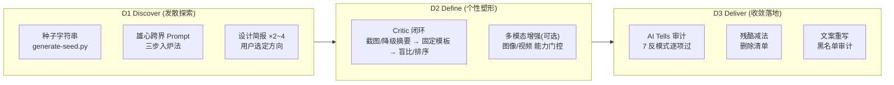

# `taste-driven-designer` 品味驱动设计技能架构设计书 (Architecture & Design Specification)

> **文档控制信息**
> - **文档标识**: SKILL-DES-TASTE-DRIVEN-DESIGNER-2026
> - **当前版本**: V1.2.0
> - **文档状态**: Active
> - **生效日期**: 2026-11-23
> - **文档所有者**: 核心架构组
> - **技能入口**: [skills/taste-driven-designer/SKILL.md](../../../skills/taste-driven-designer/SKILL.md)
> - **理论基准**: [《How to Turn Your AI into a World-Class Designer》](../../reference/articles/how-to-turn-your-ai-into-a-world-class-designer.md)（Anshu Chimala，REF-ART-AI-DESIGNER-2026）
> - **反模式与反证锚点**: [ai-tells-audit.md](../../../skills/taste-driven-designer/references/ai-tells-audit.md)、[critic-gate-counter-evidence.md](../../../skills/taste-driven-designer/tests/fixtures/critic-gate-counter-evidence.md)
> - **产物验收接口**: `frontend-qa-gate`（五域产物级验收），本技能不重复实现

---

### 修订历史记录 (Revision History)

| 版本号 | 修订日期 | 修订人 | 审核人 | 修订描述 |
| :--- | :--- | :--- | :--- | :--- |
| **V1.2.0** | 2026-11-23 | AI Agent | 核心架构组 | 修正 `ef7e325` 误覆写事故：恢复 V1.1.0 真实架构与 §8.1 三条显式偏离（D1–D3），纠偏「无自动化测试」失实表述并如实记录 `test_generate_seed.py` / `test_gate_contract.py`；保留与 `frontend-qa-gate` 分工及证据三态说明；脚本引用升级至 `scripts/generate-seed.py`（注明 POSIX `.sh` 兼容壳） |
| **V1.1.0** | 2026-09-21 | AI Agent | 核心架构组 | 依据实跑反证（E1–E6）将「Critic 绝对评分门禁」升级为三信号门禁（结构清单 + 盲比改进 + 人类签收），新增 §8.1 显式偏离登记与契约回归测试 |
| **V1.0.0** | 2026-09-20 | AI Agent | 核心架构组 | 初版：建立 AI 双钻三阶段拓扑、外部随机种子、分离式 Critic、能力门控矩阵与质量测试策略 |

---

## 1. 背景与目标 (Problem & Goals)

大语言模型（LLM）是 **Next-Token Predictor + RLHF** 的产物：每次设计决策（配色、布局、文案）都倾向选择「最可能取悦大多数人的安全 Token」。结果是千篇一律的 **AI Slop**——紫色渐变、左文右图 Hero、Bento 卡片、居中大标题、营销空话。**模型不是瓶颈，工作流才是**：多数使用者只触发了模型约 1% 的创意潜力。

结构目标（对齐仓库既有技能规格）：

1. **可执行**：把方法论落成可运行的阶段门禁（D1 发散 → D2 打磨 → D3 收敛），而非抽象建议；
2. **宿主无关**：Critic 派发、截图捕获、图像/视频增强全部按宿主能力门控，缺能力即显式降级，不绑定任何厂商工具；
3. **可核验**：完成判据由「结构清单 + 盲比改进 + 人类签收」三信号构成，配合评审账本与 5 轮预算，让「设计好不好」从主观争论变成可审计轨迹；绝对分数只作遥测；
4. **职责清晰**：与 `frontend-qa-gate` 明确分工——本技能管**视觉品味与设计减法**（好不好看），`frontend-qa-gate` 管**五域产物可用性验收**（能不能用）。

---

## 2. 理论支柱 (Theoretical Pillars)

| 支柱 | 来源 | 对应机制 |
| :--- | :--- | :--- |
| **AI 双钻模型**（Discover / Define / Deliver） | Anshu Chimala 重构版 | [SKILL.md](../../../skills/taste-driven-designer/SKILL.md) 三阶段路由，见 §3 |
| **String Seed of Thought** | Sakana AI 公开论文 | `scripts/generate-seed.py` 外部随机种子（`scripts/generate-seed.sh` 保留为 POSIX 兼容壳）；口头「随机指令」明确判无效 |
| **分离式批判 (Separated Critic)** | 文章 Technique 3 | 全新上下文 + 固定模板 + 只看产物的 Critic 闭环；签收权在人（三信号门禁） |
| **多模态资产** | 文章 Technique 4/5 | 能力门控增强层：图像生成 + 视频动效（循环抠像 / 关键帧插值） |
| **残酷减法与 AI Tells** | 文章 Technique 6/7/8 | 7 大反模式清单 + 减法规则 + 文案黑名单 |

**黄金公式**：`World-Class AI Design = 外部随机种子 + 独立 Critic 闭环 + 多模态增强 + 残酷减法`。

---

## 3. 三阶段流程拓扑 (Three-Stage Process Topology)

**阶段门禁**（流程的硬边界）：
- **D1 出口**：≥2 份方向简报 + 用户选定方向；
- **D2 出口**：三信号同时满足——结构清单全过 + 盲比有改进（或判定收敛）+ 人类签收（评审账本落盘）；每轮内嵌分钟级产物自检（状态矩阵与响应式抽查，不替代 QA Gate）；
- **D3 出口**：7 反模式逐项过审 + 删除清单 + 文案黑名单清零 + 证据三态标注完整。

---

## 4. Critic 闭环设计 (Critic Loop Design)

### 4.1 为什么必须分离

实现者自带代码、决策与理由进入审查时无法 zoom out——自我美化是 LLM 的天然倾向。Critic 的成立前提是**信息隔离**：

| 输入 | 允许 | 禁止 |
| :--- | :---: | :--- |
| 当前产物截图 / 降级结构化摘要（带轮次 nonce） | ✅ | — |
| 设计意图与约束（方向、禁忌、**已决原则台账**） | ✅ | — |
| 上一版产物（仅盲比模式，左右随机去标识） | ✅ | — |
| 实现代码、实现细节 | ❌ | 只有产物 |
| 前次批评、历史迭代 | ❌ | 由主智能体消化转译（冲突按 §4.3 仲裁） |

### 4.2 三信号门禁与收敛

详细闭环规程见 [critic-loop-protocol.md](../../../skills/taste-driven-designer/references/critic-loop-protocol.md)：

- **Gate A 结构清单**：7 AI Tells + 层级/间距/状态/文案审计 + 状态矩阵/视口抽查/无障碍基线/证据三态，逐项可核验（客观、低噪声）；
- **Gate B 盲比改进**：上一版 vs 当前版强制选择（左右随机、去标识），输出「哪个更好 + 胜出维度 + 回归维度」；不得输出分数；「无法区分」是合法结论并计入无改进；
- **Gate C 人类签收**：创意总监基于盲比轨迹、清单结果与未决分歧明确放行；
- **参考排序**（基线/争议）：一屏「4 专业参考 + 1 产物」输出 1..5 名次与关键差距，硬禁数值评分；
- **遥测分数**：若记录 x/10，需锚点示例 + 双 Critic 中位数，只进遥测栏，永不参与门禁判定；
- **预算**：冷启动 1~2 轮验证盲比信号有效；累计派发硬上限 5 轮（作废轮次不计），达限熔断上报用户。

### 4.3 鉴别力自检与冲突仲裁

- **回执与匿名性**：每轮用与候选身份无关的**轮次 nonce** 回执；版本标识只进账本、不进送审画面；回执缺失/不匹配/空白产物 → 该轮作废不入账，**连续 2 轮作废即停止并升级**（产物管线故障）；
- **鉴别力自检**：输入实质不同而输出逐字一致 → 判定 Critic 失效，立即升级人工，不再消耗轮次；
- **原则优先**：建议与「已决原则台账」冲突时，原则优先并记入台账，交人类裁决；
- **防乒乓**：同一维度前后两轮建议反转 → 冻结该维度，交人类裁决后执行。

### 4.4 证据三态契约

交付说明必须按三态逐项标注，供下游验收交接：

| 状态 | 含义 |
| :--- | :--- |
| **已实现** | 代码/样式已写入产物 |
| **已运行验证** | 在真实浏览器/视口中实际渲染并观察过 |
| **未验证** | 仅按设计推断，未实际运行 |

禁止把「已实现」写成「已运行验证」；未验证项不得写成通过。

### 4.5 与仓库既有技能的协同

- **与 `frontend-qa-gate` 分工**：本技能 D2 内的「产物自检」只做**分钟级抽查**（状态矩阵与响应式抽一两个断点），**不派发** QA Gate；完整五域产物级验收（响应式/交互状态/无障碍/浏览器覆盖/性能）在 D3 之后由 `frontend-qa-gate` 独立执行。设计迭代周期短（分钟级），全量验收留在交付前可避免循环减速，同时兜底「好看但不可用」；
- **与 `dual-round-review` 协同**：复用其宿主无关派发约定（能力优先、上下文隔离）；两者对象不同——`dual-round-review` 审**代码正确性与架构风险**，本技能 Critic 审**视觉品味**，互不替代；
- **与 `goal-loop` 协同**：长程目标若含前端设计子阶段，由 `goal-loop` 编排并在 P3 内挂载本技能的 D1/D2/D3；独立 UI 设计任务直接以本技能为主流程；
- **落地执行技能**：`frontend-design` / `canvas-design` / `web-artifacts-builder` 等在本技能选定方向后作为 D2/D3 的落地工具被调度。

---

## 5. 能力门控矩阵 (Capability Gating Matrix)

| 宿主能力 | 默认路径 | 缺失时的降级 |
| :--- | :--- | :--- |
| 截图能力 | D2/D3 真截图 Critic 评审 | 结构化摘要评审（语义树 + 视觉参数 + 关键区段，脱敏实现意图） |
| 图像生成 | 增强层 1：真实图像资产（玻璃/3D/贴图） | 代码级质感（着色器 / CSS 纹理），跳过增强 |
| 视频生成 | 增强层 2：循环抠像资产 + 关键帧插值转场 | 跳过动效增强，保留 CSS 过渡品质 |

**总原则**：能力有则用、无则降级或跳过，**永远不假装有截图**。

---

## 6. 角色模型 (Role Model)

| 角色 | 承担者 | 职责边界 | 不做什么 |
| :--- | :--- | :--- | :--- |
| **创意总监 (Creative Director)** | **人类（用户）** | 方向裁决、品味标杆、签收放行、冲突与乒乓的最终仲裁 | 不写代码 |
| **Critic (品味裁判)** | 昂贵强视觉模型，独立子智能体 | 盲比选择 / 排序定位、指出 AI tells 与最高杠杆删除项 | 不看实现、不给绝对分数、不签收 |
| **实现者 (主智能体)** | 主流执行模型 | 种子注入、生成 nonce、派发与回执校验、账本记账、精准修改与减法 | 不自评「我觉得好」 |
| **`frontend-qa-gate` (产物验收)** | 独立验收流 | 五域产物断言（响应式/状态/无障碍/浏览器/性能） | 不评美学 |

---

## 7. 质量指标与测试策略 (Quality Metrics & Test Strategy)

虽然最终美学品味必须归人类签收，但本技能的**外部熵脚本与门禁契约均由自动化 `pytest` 测试守护**（并非无测试）：

| 层次 | 指标 / 门禁 | 覆盖文件与要点 |
| :--- | :--- | :--- |
| **L0 静态** | Python 语法检查、`bash -n`（POSIX `.sh` 兼容壳）、`git diff --check` | `scripts/generate-seed.py`、`scripts/generate-seed.sh` |
| **L1 脚本单元** | `pytest`（`tests/test_generate_seed.py`，16 用例） | 默认 64 位 base62 输出、`-l`/`-c` 边界校验、确定性模式（与复刻 Park-Miller LCG 逐字节一致）、**Park-Miller 零状态钳位回归**（`-s A` / `-s AAAA` 不死锁为全 `'A'`）、真随机多样性、POSIX `.sh` 兼容壳转发一致性 |
| **L1 门禁契约** | `pytest`（`tests/test_gate_contract.py`，14 用例） | 扫描 `SKILL.md`、`references/critic-loop-protocol.md`、`references/ai-tells-audit.md`、`templates/critic-prompt-template.md`、`templates/design-brief-template.md`：句子级扫描拦截「分数/终分=完成/放行/交付」措辞变体（含自检）、三信号锚点、盲比上一版例外、轮次 nonce 与匿名性、作废二级上限、回归维度字段、已决原则台账与评审账本、反证 fixture 完整性、跨技能硬链接零违规 |
| **L-Doc 治理** | `check-doc-links.py`、`check-doc-control-sync.py`、`audit-doc-health.py` | 全域断链 0、控制头与修订历史版本一致、文档健康度 PASS |
| **方法论保真** | 人工 + 红队终审 | 8 大技法（种子/雄心 Prompt/独立批评/图像/视频/减法/AI Tells/文案重写）逐项在 `references/` 可寻址；与文章原意的偏离在 §8.1 显式登记 |

---

## 8. 边界与不承诺 (Boundaries & Non-Goals)

- 不实现截图捕获、图像/视频生成的宿主绑定代码——只提供协议与门控；
- 不承诺「一定好看」或「零 AI 痕迹」的事实保证——本技能提高下限（消除 AI Slop）与探索上限（外部种子），美学终审归人；
- 不承诺绝对分数具备跨任务可比性——无锚点分数不构成任何判据；
- 不替代设计系统长期治理（Token 库、组件库演进）；
- 不替代可用性/无障碍/性能验收（见 §4.5，由 `frontend-qa-gate` 负责）；
- 不覆盖纯后端/数据逻辑任务；非视觉诉求不触发本技能；
- 不修改仓库既有技能与第三方锁定技能本体。

### 8.1 与文章原意的显式偏离 (Registered Deviations)

| # | 文章原意 | 本技能 V1.1+ 的处置 | 依据 |
| :---: | :--- | :--- | :--- |
| D1 | "Your work is only complete when the critic independently deems it 9/10 or higher." | 不把任何绝对分数作为完成判据；分数降为遥测（需锚点 + 双 Critic 中位数） | 实跑反证：评分区间压缩、与改动无相关、输入实质变化而输出逐字相同（E1/E2/E3） |
| D2 | 判据设计一节推荐「4 专业参考 + 1 自品」相对排序 | 升为与盲比并列的**主路径**，并硬性禁止数值评分输出（只允许 1..5 名次与差距） | 原实现将其降级为「可选变体」且实际退化为打分（E4） |
| D3 | "Invoke the critic in a fresh context, with just the screenshot, not the code, implementation details, or earlier iterations/critiques."（文章 L219） | Critic 额外接收**设计意图与已决原则台账**（仍不接收代码与实现细节） | E5/E6：无意图输入的评审凭空发明需求（「伪终端装饰」）并与已决规范「线胜于面」冲突；隔离的对象是**实现**，不是**意图** |
