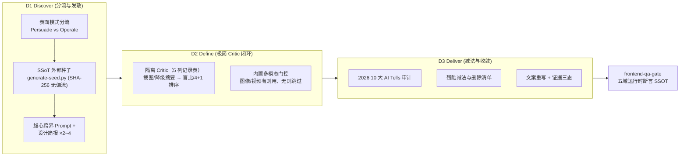

# `taste-driven-designer` 品味驱动设计技能架构设计书 (Architecture & Design Specification)

> **文档控制信息**
> - **文档标识**: SKILL-DES-TASTE-DRIVEN-DESIGNER-2026
> - **当前版本**: V2.0.0 (V2.0 瘦身提纯：新增 D1 Persuade/Operate 表面模式分流、2026 10 大 AI Tells、5 列盲比记录表、纯标准库无偏种子脚本，五域运行时验收 SSOT 完整归位 `frontend-qa-gate`)
> - **文档状态**: Active
> - **生效日期**: 2026-11-24
> - **文档所有者**: 核心架构组
> - **技能入口**: [skills/taste-driven-designer/SKILL.md](../../../skills/taste-driven-designer/SKILL.md)
> - **理论基准**: [《How to Turn Your AI into a World-Class Designer》](../../reference/articles/how-to-turn-your-ai-into-a-world-class-designer.md)（Anshu Chimala，REF-ART-AI-DESIGNER-2026）
> - **评估与调研依据**: [架构重构评估报告](../analysis/2026-11-23-taste-driven-designer-architecture-evaluation.md) · [同类前沿调研报告](../analysis/2026-11-23-taste-driven-designer-peer-research.md) · [Wave 3 实施计划](../../project/plans/2026-11-24-wave3-frontend-skills-v2.md)
> - **反模式与反证锚点**: [ai-tells-audit.md](../../../skills/taste-driven-designer/references/ai-tells-audit.md)、[critic-gate-counter-evidence.md](../../../skills/taste-driven-designer/tests/fixtures/critic-gate-counter-evidence.md)
> - **产物验收接口**: `frontend-qa-gate`（五域运行时产物验收唯一真相源），本技能不重复实现

---

### 修订历史记录 (Revision History)

| 版本号 | 修订日期 | 修订人 | 审核人 | 修订描述 |
| :--- | :--- | :--- | :--- | :--- |
| **V2.0.0** | 2026-11-24 | AI Agent | 核心架构组 | V2.0 瘦身提纯：D1 新增 `Persuade`/`Operate` 表面模式分流并合并种子流程至 `discover-phase.md`；D3 扩展 **2026 10 大 AI Tells**；D2 拆除 9 列账本与 `round-nonce` 官僚负担收敛为 **5 列评审记录表**（并入无截图降级与多模态能力门控）；移除冗余状态矩阵并将五域运行时断言 SSOT 归位 `frontend-qa-gate`；重铸纯标准库拒绝采样 `generate-seed.py`；退役冗余外壳并新建行为/表面测试套件 |
| **V1.2.0** | 2026-11-23 | AI Agent | 核心架构组 | 修正 `ef7e325` 误覆写事故：恢复 V1.1.0 真实架构与 §8.1 三条显式偏离（D1–D3），纠偏「无自动化测试」失实表述并如实记录种子脚本与门禁契约测试套件；保留与 `frontend-qa-gate` 分工及证据三态说明；脚本引用升级至 `scripts/generate-seed.py` |
| **V1.1.0** | 2026-09-21 | AI Agent | 核心架构组 | 依据实跑反证（E1–E6）将「Critic 绝对评分门禁」升级为三信号门禁（结构清单 + 盲比改进 + 人类签收），新增 §8.1 显式偏离登记与契约回归测试 |
| **V1.0.0** | 2026-09-20 | AI Agent | 核心架构组 | 初版：建立 AI 双钻三阶段拓扑、外部随机种子、分离式 Critic、能力门控矩阵与质量测试策略 |

---

## 1. 背景与目标 (Problem & Goals)

大语言模型（LLM）是 **Next-Token Predictor + RLHF** 的产物：每次设计决策（配色、布局、文案）都倾向选择「最可能取悦大多数人的安全 Token」。结果是千篇一律的 **AI Slop**——从早期赛博紫渐变、药丸卡片，进一步演化为模板字体配过度玻璃态、同质化 3 列 Bento 网格、Emoji 替图标与无意义漂浮微动效等 2026 高频套路。**模型不是瓶颈，工作流才是**。

经过 V1.x 实证评估，原流程虽沉淀了高含金量的「三信号相对盲比/4+1 排序 Critic 协议」，但叠建了过多文书仪式（9 列评审账本、`round-nonce` 回执、冗余状态矩阵），且缺少对不同产品表面的模式区分。V2.0 确立四项精简结构目标：

1. **表面适配与高杠杆破平庸**：D1 前置 `Persuade` vs `Operate` 表面模式分流，使营销落地页大胆破局而工具工作台保持信息密度与操作克制；常规 UI 编码规范可与外部通用技能协同，本技能聚焦高增量品味杠杆；
2. **低摩擦独立 Critic**：用 **5 列评审记录表**替代 9 列重账本与 `round-nonce` 文书税，保留盲比匿名去标识、空白截图作废、鉴别力自检、原则优先与防乒乓、5 轮上限全部硬护栏；
3. **宿主无关、诚实降级**：Critic 派发、截图捕获、图像/视频增强全部按宿主能力门控，缺能力即显式降级并标明证据三态，绝不假装看过截图；
4. **单一真相源职责正交**：本技能管**视觉品味、表面模式、盲比收敛与残酷减法**（好不好看），五域运行时产物可用性断言的**唯一真相源（SSOT）归位 `frontend-qa-gate`**（能不能用）。

---

## 2. 理论支柱 (Theoretical Pillars)

| 支柱 | 来源 | 对应机制 |
| :--- | :--- | :--- |
| **AI 双钻模型**（Discover / Define / Deliver） | Anshu Chimala 重构版 | [SKILL.md](../../../skills/taste-driven-designer/SKILL.md) 三阶段路由，见 §3 |
| **表面模式分流**（`Persuade` / `Operate`） | 2026 前沿实践（`pbakaus/impeccable`） | D1 前置判定页面意图：叙事说服型开启高张力发散，效率操作型锁定密度与克制，见 [discover-phase.md](../../../skills/taste-driven-designer/references/discover-phase.md) |
| **String Seed of Thought (SSoT)** | Sakana AI 公开论文 | `scripts/generate-seed.py`（纯标准库 `argparse` + `secrets` + `hashlib.sha256` 拒绝采样无偏流），步骤已整合进 [discover-phase.md](../../../skills/taste-driven-designer/references/discover-phase.md)；口头「随机指令」明确判无效 |
| **分离式批判 (Separated Critic)** | 文章 Technique 3 + E1–E7 反证 | 全新上下文 + 只看产物的 5 列评审记录表闭环；签收权在人（三信号门禁），内置无截图降级与多模态门控，见 [critic-loop-protocol.md](../../../skills/taste-driven-designer/references/critic-loop-protocol.md) |
| **2026 10 大 AI Tells 与残酷减法** | 文章 Technique 6/7/8 + 2026 代际审计 | [ai-tells-audit.md](../../../skills/taste-driven-designer/references/ai-tells-audit.md)（10 大反模式逐项过审 + 删除清单 + 文案黑名单） |

**黄金公式**：`World-Class AI Design = 表面模式分流 + 外部随机种子 + 独立极简 Critic 闭环 + 能力门控多模态 + 2026 反 Slop 与残酷减法`。

---

## 3. 三阶段流程拓扑 (Three-Stage Process Topology)

**阶段门禁**：
- **D1 出口**：已确定 `Persuade` / `Operate` 表面模式 + ≥2 份方向简报 + 用户选定方向；
- **D2 出口**：三信号同时满足——Gate A 结构自审通过 + Gate B 盲比有改进（或全维度无法区分判定收敛）+ Gate C 人类签收（5 列评审记录表落盘，累计 ≤ 5 轮）；
- **D3 出口**：2026 10 大 AI Tells 逐项过审 + 删除清单 + 文案黑名单清零 + 证据三态标注完整；完成后移交 `frontend-qa-gate` 执行五域运行时产物验收。

---

## 4. Critic 闭环设计 (Critic Loop Design)

### 4.1 为什么必须分离

实现者自带代码、决策与理由进入审查时无法 zoom out——自我美化是 LLM 的天然倾向。Critic 的成立前提是**信息隔离**：

| 输入 | 允许 | 禁止 |
| :--- | :---: | :--- |
| 当前产物截图 / 无截图降级结构化摘要 | ✅ | — |
| 设计意图与约束（表面模式、方向、禁忌、**已决原则台账**） | ✅ | — |
| 上一版产物（仅盲比模式，左右随机、匿名去标识） | ✅ | — |
| 实现代码、实现细节 | ❌ | 只有产物 |
| 前次批评、历史迭代、任何绝对目标分 | ❌ | 由主智能体消化转译（冲突按 §4.3 仲裁） |

### 4.2 三信号门禁与 5 列评审记录表

详细闭环规程见 [critic-loop-protocol.md](../../../skills/taste-driven-designer/references/critic-loop-protocol.md)：

- **Gate A 结构清单**：2026 10 大 AI Tells 审计 + 视觉层级/间距节奏/核心交互质感/文案黑名单审计 + 证据三态标注（V2.0 彻底移除冗余状态矩阵与断点清单，完整五域运行时验收单一真相源归 `frontend-qa-gate`）；
- **Gate B 盲比改进**：上一版 vs 当前版强制选择（左右随机、完全匿名去标识），输出「哪个更好 + 胜出维度 + 回归维度」；不得输出分数；「无法区分」是合法结论并计入收敛判定；
- **Gate C 人类签收**：创意总监基于 5 列评审记录表轨迹、结构清单结果与未决分歧明确放行；
- **参考排序（4+1）**：一屏「4 专业参考 + 1 产物」输出 1..5 名次与关键差距，硬禁数值评分（首版定基线或盲比争议时使用）；
- **5 列评审记录表**：V2.0 拆除 V1.x 繁琐的 9 列账本与 `round-nonce` 文本回执负担，收敛为简洁的 **5 列评审记录表**（`轮次 | 版本 | 模式 | 结论（胜出/回归/名次） | 采纳与否决`），在保留全部审计护栏的同时大幅降低回合开销；
- **遥测分数（可选）**：若记录 x/10，需锚点示例 + 双 Critic 中位数，只进遥测栏，永不参与门禁判定；
- **预算**：冷启动 1~2 轮验证盲比信号有效；累计有效派发硬上限 **5 轮**（作废轮次不计），达限熔断上报用户。

### 4.3 匿名性、作废规则与冲突仲裁

- **匿名去标识与作废**：盲比候选图/摘要严禁出现版本号、文件名提示或 UI 版本水印；空白或未加载产物截图直接判为**作废不入有效轮次**，**连续 2 轮作废即停机并升级人工**（排查渲染与截图管线故障）；
- **鉴别力自检**：输入实质变化而 Critic 输出逐字或结论完全不变 → 判定 Critic 本轮失效，立即停机升级人工，不再空烧轮次；
- **原则优先**：Critic 建议与「已决原则台账」冲突时，原则优先并记入 5 列评审记录表，交人类裁决；
- **防乒乓**：同一维度前后两轮建议互斥反转 → 冻结该维度，交人类裁决后执行。

### 4.4 证据三态契约与无截图降级

交付说明按三态逐项标注，严禁把「已实现」写成「已运行验证」或将未验证项宣称通过：

| 状态 | 含义 |
| :--- | :--- |
| **已实现** | 代码/样式已写入产物 |
| **已运行验证** | 在真实浏览器/视口中实际渲染并观察过 |
| **未验证** | 仅按设计推断，未实际运行 |

原独立多模态增强文档已合并进 [critic-loop-protocol.md](../../../skills/taste-driven-designer/references/critic-loop-protocol.md)：宿主具备图像/视频生成能力时作为增强层按需触发；无截图能力时降级为「语义结构树 + 视觉参数表 + 关键视觉代码片段（脱敏实现意图、保留设计意图）」结构化摘要送审，并在交付说明中显式标注未实机截屏。

### 4.5 与仓库既有技能的协同（SSOT 分工纠偏）

- **与 `frontend-qa-gate` 分工（SSOT 归位）**：本技能不再重复维护状态矩阵或断点检查单；**五域运行时产物验收（响应式视口 / 交互状态 / 无障碍 / 性能预算及 Tier 2 人工真机清单）的唯一真相源归 `frontend-qa-gate`**，在 D3 之后独立执行。本技能专注解决「设计是否有灵魂、是否摆脱 AI Slop、信息层级是否经盲比打磨」，两者互补而不重叠；
- **与通用审美/实现技能协同**：常规编码规范可调用 `frontend-design` / `canvas-design` / `web-artifacts-builder` 等执行层技能，本技能提供跨界外部熵发散、表面模式分流、独立盲比 Critic 闭环与 D3 减法审计；
- **与 `dual-round-review` 协同**：`dual-round-review` 审**代码正确性与架构风险**，本技能 Critic 审**视觉品味**，互不替代；
- **与 `goal-loop` 协同**：长程前端设计交付由 `goal-loop` 在 `Execute` 内调度本技能 D1–D3，再于 `Verify` 子步骤 4.2 经过 `frontend-qa-gate` Tier 1 真实磁盘证据门禁 `PASS` 后进入 `dual-round-review`。

---

## 5. 能力门控矩阵 (Capability Gating Matrix)

| 宿主能力 | 默认路径 | 缺失时的降级 |
| :--- | :--- | :--- |
| 截图能力 | D2/D3 真截图 Critic 盲比/排序 | 结构化摘要评审（语义结构树 + 视觉参数 + 关键视觉片断，脱敏实现意图） |
| 图像生成 | 增强层 1：真实图像资产（质感/3D/主视觉） | 代码级质感（着色器 / CSS 纹理），跳过增强 |
| 视频生成 | 增强层 2：循环抠像资产 + 关键帧插值转场 | 跳过动效增强，保留克制 CSS 过渡品质 |

**总原则**：能力有则用、无则降级或跳过，**永远不假装有截图**。

---

## 6. 角色模型 (Role Model)

| 角色 | 承担者 | 职责边界 | 不做什么 |
| :--- | :--- | :--- | :--- |
| **创意总监 (Creative Director)** | **人类（用户）** | 表面模式确认、方向裁决、品味标杆、签收放行、冲突与乒乓的最终仲裁 | 不写代码 |
| **Critic (品味裁判)** | 强视觉模型，独立子智能体 | 盲比选边 / 4+1 排序、指出 2026 AI tells 与最高杠杆删除项 | 不看实现代码、不给绝对分数、不签收 |
| **实现者 (主智能体)** | 主流执行模型 | 表面分流、种子注入、匿名化派发与空白/鉴别力检查、维护 5 列评审记录表、减法与文案重写 | 不自评「我觉得好」 |
| **`frontend-qa-gate` (产物验收)** | 独立验收流 | 五域运行时产物断言（Tier 1 自动化 23 项 + Tier 2 人工真机 4 项） | 不评美学 |

---

## 7. 质量指标与测试策略 (Quality Metrics & Test Strategy)

外部随机种子算法与技能交付面哨兵均由纯标准库脚本与自动化 `pytest` 守护（摒弃 lock 中文散文的脆弱正则断言）：

| 层次 | 指标 / 门禁 | 覆盖文件与要点 |
| :--- | :--- | :--- |
| **L0 静态** | `python3 -m py_compile`、`git diff --check` | `scripts/generate-seed.py` 语法与空白零残留 |
| **L1 种子脚本行为单测** | `pytest`（`tests/test_taste_generate_seed.py`） | 纯标准库 `argparse` + `secrets` + `hashlib.sha256` 拒绝采样无偏流、默认 64 位 base62 输出、`-l`/`-c` 边界与非法参数校验、`-s` 确定性可复现、**消除历史 Park-Miller 零状态钳位死锁回归**（`-s A` / `-s AAAA` 输出具有高熵分布而非全 `'A'`）、真随机多样性 |
| **L1 表面与防回流哨兵** | `pytest`（`tests/test_taste_designer_v2_surface.py`） | `SKILL.md` YAML frontmatter 与 `description` 长度预算、全技能 Markdown 围栏闭合与相对链接可达性、`Persuade`/`Operate` 表面模式与 2026 10 大 AI Tells 与 5 列记录表及无绝对分数判据表面校验、反证 fixture 完整性、跨技能硬链接零违规及已退役旧文件防回流哨兵 |
| **L-Doc 治理** | `python3 scripts/doc-gates/check-all.py --full` | 全域断链 0、文档三态与体量体检 PASS、可回答性评测无 FAIL、全仓 `pytest` 全绿 |
| **方法论保真** | 人工 + 红队终审 | 核心技法（表面分流 / 外部种子 / 独立 5 列盲比 Critic / 能力门控多模态 / 减法 / 2026 10 大 AI Tells / 文案重写）在 `references/` 可寻址；与文章原意偏离见 §8.1 |

---

## 8. 边界与不承诺 (Boundaries & Non-Goals)

- 不实现截图捕获、图像/视频生成的宿主绑定代码——只提供协议与能力门控；
- 不承诺「一定好看」或「零 AI 痕迹」的事实保证——本技能提高下限（消除 AI Slop）与探索上限（外部种子），美学终审归人；
- 不承诺绝对分数具备跨任务可比性——无锚点分数不构成任何判据；
- 不替代设计系统长期治理（Token 库、组件库演进）；
- 不替代可用性/无障碍/性能验收（五域运行时断言 SSOT 已归位 `frontend-qa-gate`）；
- 不覆盖纯后端/数据逻辑任务；非视觉诉求不触发本技能；
- 不修改仓库既有技能与第三方锁定技能本体。

### 8.1 与文章原意的显式偏离 (Registered Deviations)

| # | 文章原意 | 本技能 V1.1+ 的处置 | 依据 |
| :---: | :--- | :--- | :--- |
| D1 | "Your work is only complete when the critic independently deems it 9/10 or higher." | 不把任何绝对分数作为完成判据；分数降为遥测（需锚点 + 双 Critic 中位数） | 实跑反证：评分区间压缩、与改动无相关、输入实质变化而输出逐字相同（E1/E2/E3） |
| D2 | 判据设计一节推荐「4 专业参考 + 1 自品」相对排序 | 升为与盲比并列的**主路径**，并硬性禁止数值评分输出（只允许 1..5 名次与差距） | 原实现将其降级为「可选变体」且实际退化为打分（E4） |
| D3 | "Invoke the critic in a fresh context, with just the screenshot, not the code, implementation details, or earlier iterations/critiques."（文章 L219） | Critic 额外接收**设计意图与已决原则台账**（仍不接收代码与实现细节） | E5/E6：无意图输入的评审凭空发明需求（「伪终端装饰」）并与已决规范「线胜于面」冲突；隔离的对象是**实现**，不是**意图** |
